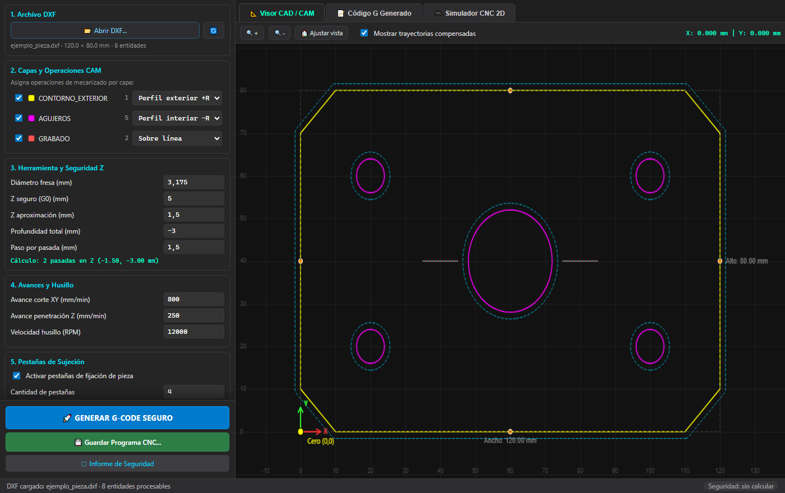
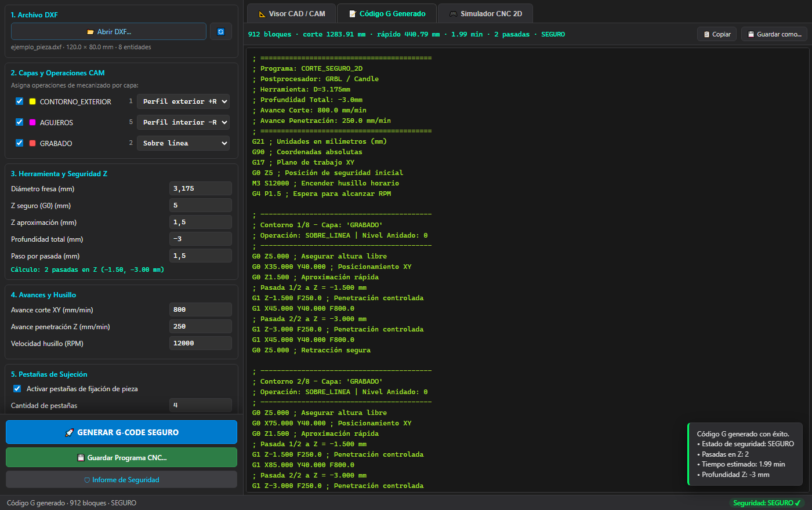
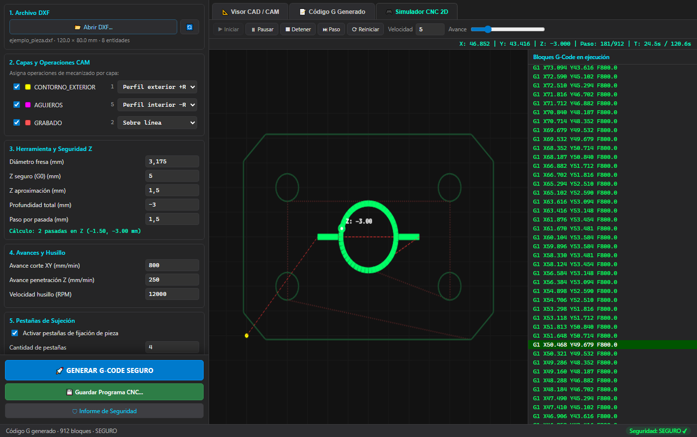

# CAD-CAM 2D CNC · Generador de Trayectorias Seguras

Aplicación de escritorio multiplataforma para importar archivos DXF y generar programas de
código G con **trayectorias seguras** para máquinas CNC 2D / 2.5D: routers, fresadoras,
cortadoras láser, plasma y plóters.

Está construida con **Electron** y funciona en Windows, macOS y Linux con el mismo código.
Sustituye a la versión anterior en Python + Tkinter, conservando el mismo flujo de trabajo, el
formato del código G y las reglas de seguridad, pero sin requerir Python ni dependencias
nativas del sistema.

---

## Características

### 1. Motor CAD

- **Importación DXF**: `LINE`, `ARC`, `CIRCLE`, `LWPOLYLINE`, `POLYLINE` (con *bulges* de
  arco), `SPLINE` (NURBS con vector de nudos) y `ELLIPSE`.
- **Bloques**: los `INSERT` se expanden de forma recursiva, incluyendo giro, escala, punto
  base y arreglos `MINSERT` (filas y columnas).
- **Gestión de capas**: lista interactiva con visibilidad y asignación de operación CAM por
  capa, con inferencia automática según el nombre (`AGUJERO`, `GRABADO`, `POCKET`, `DRILL`…).
- **Encadenado automático**: une líneas, arcos y polilíneas sueltas en contornos continuos con
  tolerancia configurable.
- **Visor gráfico**: zoom con la rueda anclado al puntero, desplazamiento con arrastre,
  cuadrícula milimétrica, cotas de la pieza y marcador del cero pieza.
- **Lectura en tiempo real** de las coordenadas del cursor en milímetros.

### 2. Motor CAM y trayectorias seguras

- **Planos de seguridad Z**
  - *Z seguro* (clearance): altura obligatoria de todos los traslados rápidos `G0`.
  - *Z aproximación* (retract): altura intermedia antes de penetrar.
- **Inside-First**: análisis topológico de anidado que mecaniza agujeros, cajeras y ranuras
  interiores **antes** del contorno exterior, para que la pieza no se suelte.
- **Compensación de radio de fresa**
  - `PERFIL_EXTERIOR`: desplaza el filo hacia fuera (+R).
  - `PERFIL_INTERIOR`: desplaza el filo hacia dentro (-R).
  - `SOBRE_LINEA`: corta sobre el vector (grabado, láser, plasma).
  - `CAJEADO`: pasadas concéntricas con solapamiento hasta vaciar la cajera.
  - `TALADRADO`: ciclo de taladrado en el centro de los círculos.
- **Pasadas múltiples en Z**: reparte la profundidad en capas uniformes que nunca superan el
  paso por pasada, con penetración a avance controlado.
- **Pestañas de sujeción**: puentes de material configurables en cantidad, ancho y altura.
- **Optimización de recorridos**: algoritmo voraz (TSP) para minimizar traslados en vacío.

### 3. Simulador CNC 2D / 2.5D

- Traslados rápidos en rojo punteado, cortes en verde con el ancho real de la fresa, pestañas
  en naranja y recorridos sobre la superficie en cian.
- Reproducción con iniciar, pausar, detener, paso a paso y reiniciar.
- Barra de avance (*scrub*) para saltar a cualquier punto del programa.
- Control de velocidad de 1× a 50×.
- Lista de bloques G-code sincronizada con la ejecución.
- Telemetría de X, Y, Z, tiempo transcurrido y tiempo total estimado.

### 4. Verificador de seguridad pre-vuelo

Antes de enviar el programa a la máquina comprueba:

- que no existan movimientos rápidos `G0` en XY por debajo de Z seguro,
- que el husillo esté encendido (`M3`) antes de tocar material,
- que la penetración en Z use un avance controlado,
- que no se exceda la profundidad programada,
- que el programa termine con retracción a Z seguro y `M5`.

El estado se resume en **SEGURO ✔**, **ADVERTENCIA ⚠** o **PELIGRO ✖**, con informe exportable.

### 5. Postprocesadores

GRBL / Candle / CNCjs / UGS · Mach3 / Mach4 · LinuxCNC · Marlin CNC · Láser / Plasma 2D ·
Genérico ISO.

---

## Capturas

| Visor CAD / CAM | Código G generado | Simulador CNC 2D |
| --- | --- | --- |
|  |  |  |

---

## Requisitos

- **Node.js 20 o superior** y npm (solo para desarrollo y empaquetado).
- La aplicación ya compilada no necesita Node ni Python.

## Instalación y uso

```bash
npm install     # instala Electron y las dependencias
npm start       # abre la aplicación
```

Al arrancar se carga automáticamente el ejemplo incluido en `examples/`.

### Flujo de trabajo típico

1. **Abrir DXF** con el botón `📂 Abrir DXF...` (o `Ctrl/Cmd + O`).
2. **Revisar capas**: asigna la operación CAM de cada capa.
3. **Configurar herramienta y Z**: diámetro de fresa, Z seguro, profundidad total, paso por
   pasada y pestañas.
4. **Generar** con `🚀 GENERAR G-CODE SEGURO` (`F5`).
5. **Simular y verificar** en la pestaña `🎮 Simulador CNC 2D` y revisar el informe (`F6`).
6. **Guardar** el programa con `💾 Guardar Programa CNC...` (`Ctrl/Cmd + S`).

---

## Scripts disponibles

| Script | Descripción |
| --- | --- |
| `npm start` | Abre la aplicación |
| `npm run dev` | Abre la aplicación con las herramientas de desarrollo |
| `npm run preview:ui` | Genera una maqueta de la interfaz en `.cache/preview/` para abrir en un navegador |
| `npm test` | Ejecuta la batería de pruebas automatizadas |
| `npm run pack` | Empaqueta la aplicación sin instalador (`release/`) |
| `npm run dist` | Genera el instalador de la plataforma actual |
| `npm run dist:win` | Instalador de Windows (NSIS + portable) |
| `npm run dist:mac` | Instalador de macOS (DMG + ZIP) |
| `npm run dist:linux` | Instalador de Linux (AppImage + deb) |

Los instaladores se generan en `release/`. Para publicar con icono propio, coloca
`build/icon.png` (512×512 o mayor); electron-builder deriva los formatos de cada plataforma.

> Nota: los instaladores de macOS deben generarse en macOS, y los de Linux en Linux, para
> obtener binarios firmados y compatibles.

---

## Estructura del proyecto

```
dxf2gcode/
├── package.json               # Dependencias, scripts y configuración de empaquetado
├── build/
│   ├── icon.png               # Icono de la aplicación (512×512)
│   └── icon.ico               # Icono para Windows
├── scripts/
│   ├── make-icon.py           # Regenera los iconos con Pillow
│   ├── ensure-electron.js     # Garantiza el binario de Electron tras instalar
│   └── build-preview.js       # Maqueta la interfaz para verla en un navegador
├── docs/screenshots/          # Capturas de la aplicación
├── examples/
│   ├── ejemplo_pieza.dxf      # Pieza de ejemplo con capas, agujeros y contorno
│   └── ejemplo.nc             # Programa de referencia generado
├── src/
│   ├── main/
│   │   ├── main.js            # Proceso principal: ventana, IPC, diálogos, estado
│   │   └── menu.js            # Menú nativo multiplataforma
│   ├── preload/
│   │   └── preload.js         # Puente seguro entre el renderer y el proceso principal
│   ├── shared/                # Núcleo CAD/CAM (sin dependencias de la interfaz)
│   │   ├── constants.js       # Operaciones, postprocesadores, valores por defecto
│   │   ├── dxf-loader.js      # Lectura y normalización de DXF
│   │   ├── polygon-ops.js     # Offsets y contención de polígonos (Clipper)
│   │   ├── geometry.js        # Encadenado, anidado, compensación y pestañas
│   │   ├── cam-engine.js      # Generación de trayectorias y código G
│   │   ├── postprocessor.js   # Formato para cada controlador CNC
│   │   └── safety-check.js    # Verificación pre-vuelo
│   └── renderer/
│       ├── index.html         # Interfaz
│       ├── styles.css         # Tema oscuro
│       ├── util.js            # Utilidades de interfaz
│       ├── cad-view.js        # Visor CAD con zoom, pan y cotas
│       ├── sim-view.js        # Simulador y lista de bloques
│       └── app.js             # Cableado de la interfaz
└── tests/
    ├── harness.js             # Corredor de pruebas mínimo
    ├── run-tests.js           # Punto de entrada de `npm test`
    ├── core.test.js           # Pruebas del núcleo CAD/CAM
    ├── renderer.test.js       # Pruebas de la interfaz con jsdom
    └── fixtures/dxf-builder.js
```

### Arquitectura

El **proceso principal** custodia el estado de la sesión y ejecuta todo el núcleo CAD/CAM. El
**renderer** solo se ocupa de la presentación y se comunica por IPC a través de una API mínima
expuesta en el `preload` (con `contextIsolation` y `sandbox` activados). Así la lógica de
mecanizado nunca depende del DOM y puede probarse de forma aislada.

---

## Pruebas

```bash
npm test
```

Las pruebas cubren:

- **Núcleo**: teselado de arcos, círculos, *bulges*, splines NURBS y elipses; expansión de
  bloques; encadenado; jerarquía de anidado; áreas de compensación; cajeado; pestañas;
  invariantes de seguridad del código G; postprocesadores y verificador pre-vuelo.
- **Proceso principal**: creación de la ventana con aislamiento de contexto, manejadores IPC
  (carga, generación, guardado, exportación), validación de parámetros y superficie expuesta
  por el preload.
- **Interfaz**: arranque de la aplicación, carga del ejemplo, gestión de capas, generación de
  código, simulador, guardado, informe de seguridad y acciones del menú (con `jsdom` y el
  núcleo real como backend).

---

## Diagnóstico

Para pruebas de humo automatizadas la aplicación admite variables de entorno opcionales:

| Variable | Efecto |
| --- | --- |
| `DXF2GCODE_SCREENSHOT` | Ruta donde guardar una captura de la ventana al cargar |
| `DXF2GCODE_SCREENSHOT_DELAY` | Milisegundos de espera antes de capturar (por defecto 3000) |
| `DXF2GCODE_SCREENSHOT_CAPTURE=0` | No captura, solo registra la consola del renderer |
| `DXF2GCODE_SCREENSHOT_QUIT=0` | No cierra la aplicación tras la captura |

El registro se escribe junto a la captura, con extensión `.log`.

---

## Compatibilidad con DXF

Se procesan las entidades del espacio modelo (*ModelSpace*). Las entidades no soportadas
(`TEXT`, `MTEXT`, `DIMENSION`, `HATCH`, `SOLID`, `POINT`…) se ignoran y se informa de cuántas
se descartaron. Las splines racionales se tratan como no racionales, ya que los pesos no
forman parte del formato leído. Los archivos se interpretan en 2D sobre el plano XY.

---

## Solución de problemas

- **`npm start` falla con `Cannot read properties of undefined (reading
  'requestSingleInstanceLock')`**: la variable de entorno `ELECTRON_RUN_AS_NODE` está definida
  y fuerza a Electron a arrancar como Node. Elimínala de la sesión
  (`Remove-Item Env:ELECTRON_RUN_AS_NODE` en PowerShell, `unset ELECTRON_RUN_AS_NODE` en bash)
  y vuelve a intentarlo.
- **Falta el binario de Electron después de `npm install`**: algunas versiones de npm bloquean
  los scripts de instalación de las dependencias. Ejecuta `npm run setup:electron`.
- **No se generan los instaladores**: electron-builder necesita conexión a Internet la primera
  vez para descargar Electron y NSIS y guarda esa caché para las siguientes compilaciones.
- **Una capa no genera trayectorias**: comprueba que está visible y que su operación no es
  `SOBRE_LINEA` sin contornos cerrados; en ese caso el mecanizado es un recorrido directo.

---

## Licencia

MIT. Consulta [LICENSE](LICENSE).
